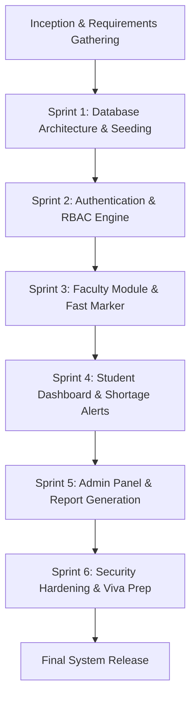
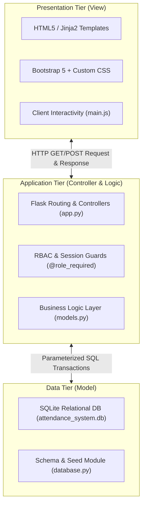
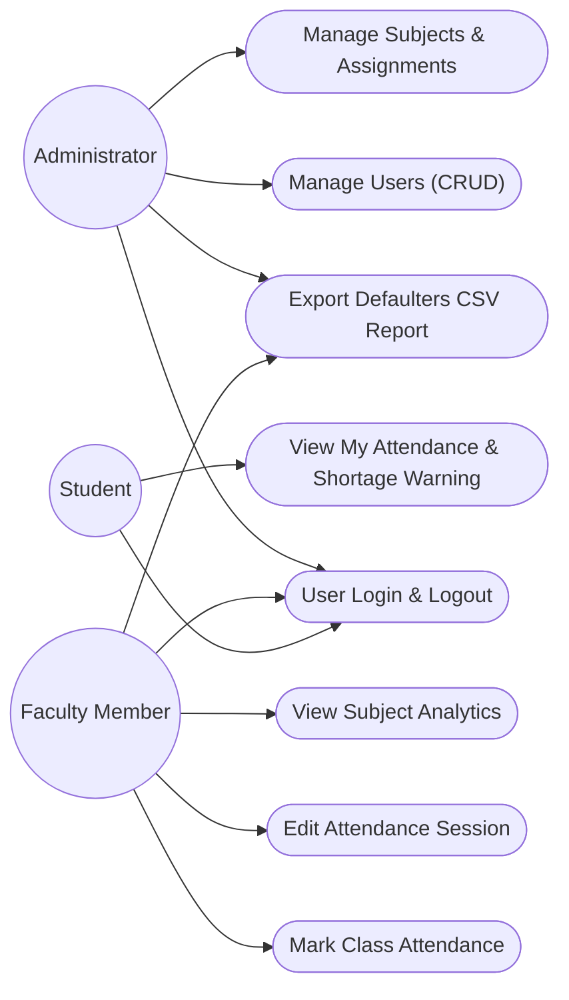
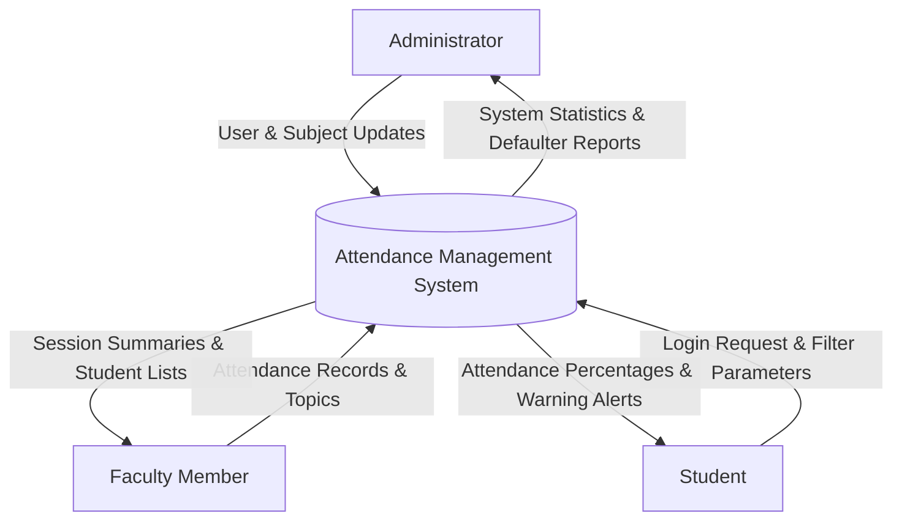
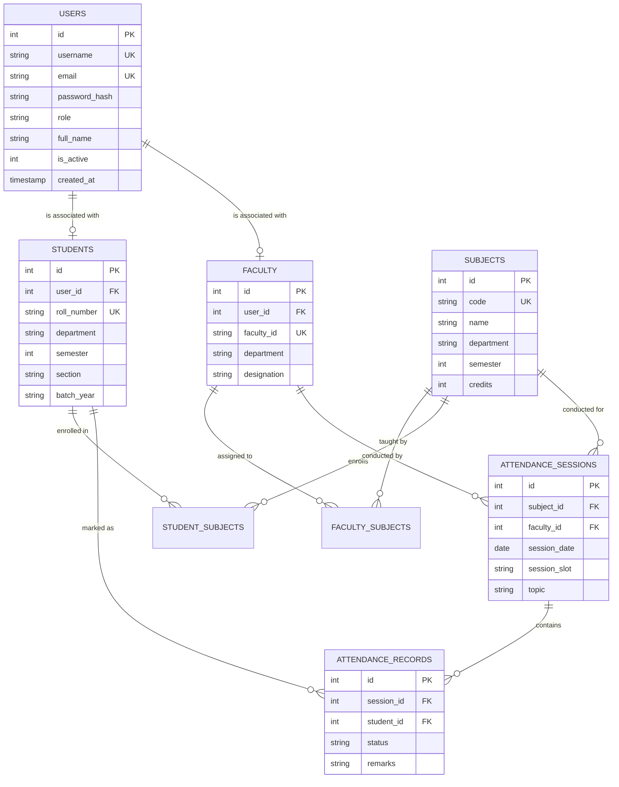

# ATTENDANCE MANAGEMENT SYSTEM (AMS)
## Software Engineering & Project Management (SEPM) Mini-Project Report

---

**Course Code:** CS603  
**Course Name:** Software Engineering and Project Management (SEPM)  
**Academic Degree:** Bachelor of Technology (B.Tech) in Computer Science & Engineering  
**Academic Year:** 2025 – 2026  
**Semester:** 6th Semester  

---

## TABLE OF CONTENTS
1. [Abstract & Executive Summary](#1-abstract--executive-summary)
2. [Introduction & Problem Statement](#2-introduction--problem-statement)
3. [Software Development Life Cycle (SDLC) Model](#3-software-development-life-cycle-sdlc-model)
4. [Software Requirement Specification (SRS - IEEE 830)](#4-software-requirement-specification-srs---ieee-830)
5. [System Architecture & Design](#5-system-architecture--design)
6. [Database Design & Entity-Relationship Modeling](#6-database-design--entity-relationship-modeling)
7. [Detailed Module Specifications](#7-detailed-module-specifications)
8. [Software Testing & Quality Assurance](#8-software-testing--quality-assurance)
9. [Project Estimation & Management (COCOMO, WBS, RMMM)](#9-project-estimation--management)
10. [Viva Voce Questions & Answers Guide](#10-viva-voce-questions--answers-guide)
11. [Conclusion & Future Enhancements](#11-conclusion--future-enhancements)
12. [References](#12-references)

---

## 1. ABSTRACT & EXECUTIVE SUMMARY

Attendance tracking in higher education institutions plays a pivotal role in maintaining academic discipline and ensuring compliance with statutory university examination regulations. The **Attendance Management System (AMS)** is a web application designed to digitize attendance workflows across departments.

Built using **Python (Flask)**, **SQLite**, **Jinja2**, and **Bootstrap 5**, the application eliminates paper-based attendance registers. It enforces **Role-Based Access Control (RBAC)** across three primary stakeholders:
- **System Administrator:** Oversees academic entities, manages student/faculty profiles, assigns subjects, audits attendance logs, and generates CSV reports.
- **Faculty:** Records lecture attendance via a marker interface featuring "Mark All Present/Absent" shortcuts, live statistical counters, and duplicate entry safeguards.
- **Student:** Monitors cumulative attendance, subject-wise statistics, and receives proactive shortage warnings when attendance falls below the statutory 75.0% threshold.

The system was seeded with 45 student records, 5 core subjects, and 100 historical lecture sessions to demonstrate performance and functionality.

---

## 2. INTRODUCTION & PROBLEM STATEMENT

### 2.1 The Traditional Attendance Process
In most conventional academic setups, attendance is marked manually in physical paper registers. Lecturers call out students' roll numbers one by one, manually ticking "P" or "A". At the end of each month or semester, clerks or faculty spend days compiling attendance registers, calculating percentage tallies, and identifying students who fall below the statutory university requirement (typically 75%).

### 2.2 Drawbacks of the Traditional System
1. **Instructional Time Wastage:** Taking manual roll call in a class of 45–60 students consumes 7 to 10 minutes out of every 50-minute lecture.
2. **Proxy Attendance & Malpractice:** Students frequently mark proxies for absent peers during rapid name calling.
3. **Delayed Shortage Detection:** Attendance shortfalls are typically compiled only at the end of the semester. Students frequently discover their ineligibility after it is too late to make up missed classes.
4. **Data Redundancy & Calculation Errors:** Manual mathematical percentage compilation across 5 to 6 subjects per student is error-prone.
5. **Physical Loss & Wear:** Paper registers are subject to physical degradation, coffee spills, or loss.

### 2.3 Proposed Solution
The Attendance Management System replaces physical ledgers with a responsive, centralized application. Attendance is recorded digitally in seconds, calculations are performed instantaneously in SQLite, and both students and faculty have transparent visibility into attendance percentages and shortage alerts.

---

## 3. SOFTWARE DEVELOPMENT LIFE CYCLE (SDLC) MODEL

### 3.1 Model Selection: Iterative / Agile Scrum
An **Iterative Agile Methodology** was adopted for AMS development. Rather than the rigid sequential flow of the Waterfall model, Agile enabled continuous functional prototyping, automated regression testing, and incremental feature delivery.

### 3.2 Justification over Waterfall Model
| Parameter | Waterfall Model | Agile Scrum Model (AMS Approach) |
| :--- | :--- | :--- |
| **Flexibility** | Inflexible; cannot accommodate changes | Highly adaptive to evolving UI/UX requirements |
| **Risk Management** | Late discovery of bugs during final testing | Early discovery through continuous sprint testing |
| **Working Software** | Available only at the final phase | Delivered incrementally after every sprint |
| **Stakeholder Feedback** | Delayed until deployment | Continuous feedback at each iteration |

---

## 4. SOFTWARE REQUIREMENT SPECIFICATION (SRS - IEEE 830)

### 4.1 Functional Requirements (FR)

- **FR-01: Secure Authentication:** Users authenticate using email or username with a password. Passwords must be hashed using PBKDF2/SHA-256 salts.
- **FR-02: Role-Based Authorization:** The system must restrict route access strictly based on the authenticated role (`admin`, `faculty`, `student`).
- **FR-03: Admin User Lifecycle Management:** Admins must be able to register, view, update, deactivate, and delete user profiles.
- **FR-04: Admin Subject Management:** Admins can define course subjects, semester levels, credits, and assign faculty instructors.
- **FR-05: Attendance Recording:** Faculty members can mark attendance for assigned subjects with date, time slot, and topic.
- **FR-06: Duplicate Submission Prevention:** The system must reject duplicate attendance sessions for the same subject, date, and slot, while providing a safe edit option.
- **FR-07: Real-Time Counter & Fast Controls:** Faculty marker interface must calculate present count, absent count, and percentage in real-time.
- **FR-08: Student Attendance Visibility:** Students can view overall attendance percentage and subject-wise breakdowns in read-only mode.
- **FR-09: Statutory Shortage Alerts:** The system must highlight attendance below 75% with a prominent visual warning banner.
- **FR-10: Defaulter Reporting & Export:** The system must generate and export CSV rosters of students failing to meet the 75% attendance threshold.

### 4.2 Non-Functional Requirements (NFR)
- **Security:** Session cookies must be cryptographically signed. Passwords must never be stored or logged in plain text.
- **Performance:** System queries must execute within 100 milliseconds for rosters up to 100 students.
- **Data Integrity:** Relational foreign keys and cascading integrity must be strictly enforced by SQLite (`PRAGMA foreign_keys = ON;`).
- **Usability:** Interface must be responsive across desktop screens, tablets, and smartphones.

---

## 5. SYSTEM ARCHITECTURE & DESIGN

### 5.1 Architecture Style: 3-Tier Layered Architecture (MVC)
AMS is designed using the **Model-View-Controller (MVC)** architectural pattern:

### 5.2 Use Case Diagram

### 5.3 Data Flow Diagram (DFD Level 0 - Context Level)

---

## 6. DATABASE DESIGN & ENTITY-RELATIONSHIP MODELING

### 6.1 Entity-Relationship Diagram (ERD)

### 6.2 Relational Schema & Normalization Analysis
1. **First Normal Form (1NF):** All table fields contain atomic values. Repeated groups are eliminated.
2. **Second Normal Form (2NF):** Every non-key column is fully functionally dependent on the entire primary key.
3. **Third Normal Form (3NF):** No transitive dependencies exist. Faculty and student details are isolated from raw user authentication records.

---

## 7. DETAILED MODULE SPECIFICATIONS

### 7.1 Five Core Curriculum Subjects
The application preconfigures five core 6th-semester Computer Science & Engineering courses:
1. `CS601` — **MDM** (Modern Database Management / Mobile Device Management)
2. `CS602` — **Theory of Computation**
3. `CS603` — **Software Engineering and Project Management (SEPM)**
4. `CS604` — **PE - Image Processing**
5. `CS605` — **Machine Learning**

### 7.2 Core Algorithms & Logic
#### A. Attendance Shortage Calculation & Advice
The statutory minimum attendance threshold is set at $T = 75.0\%$.  
For each student in a subject:
$$\text{Attendance Rate } P = \left( \frac{\text{Attended Classes } (A)}{\text{Conducted Classes } (C)} \right) \times 100$$

If $P < 75.0\%$, the student is flagged as a **Defaulter**.  
To calculate how many consecutive future classes $x$ the student must attend to attain $75\%$:
$$\frac{A + x}{C + x} \ge 0.75 \implies A + x \ge 0.75C + 0.75x \implies 0.25x \ge 0.75C - A$$
$$x = \left\lceil \frac{0.75C - A}{0.25} \right\rceil$$

If $P \ge 75.0\%$, the number of classes $y$ the student can afford to miss safely without dropping below 75% is:
$$\frac{A}{C + y} \ge 0.75 \implies y \le \left\lfloor \frac{A}{0.75} \right\rfloor - C$$

---

## 8. SOFTWARE TESTING & QUALITY ASSURANCE

### 8.1 Test Case Matrix
| Test Case ID | Test Description | Test Steps | Expected Result | Actual Result | Status |
| :--- | :--- | :--- | :--- | :--- | :--- |
| **TC-SEC-01** | Salted Password Verification | Attempt login with valid user password | PBKDF2 hash matches; session cookie generated | Login successful | **PASS** |
| **TC-SEC-02** | Role Escalation Prevention | Student attempts to navigate to `/admin` | Intercepted by `@role_required('admin')`; redirected | 403 / Redirected | **PASS** |
| **TC-ATT-01** | Duplicate Session Guard | Submit attendance for same subject, date, slot | SQLite composite constraint & model check blocks entry | Duplicate prevented | **PASS** |
| **TC-ATT-02** | Live Counter Computation | Toggle 5 students from Present to Absent | Counter shows Present: 40, Absent: 5, Rate: 88.9% | Matches in real-time | **PASS** |
| **TC-STU-01** | Defaulter Banner Activation | Student with 60% attendance logs into portal | Prominent red shortage warning banner rendered | Banner rendered | **PASS** |
| **TC-REP-01** | CSV Report Generation | Click "Export Defaulters (CSV)" | Generates RFC 4180 CSV attachment with MIME text/csv | Download triggered | **PASS** |

---

## 9. PROJECT ESTIMATION & MANAGEMENT

### 9.1 COCOMO (Constructive Cost Model) Estimation
Using Intermediate COCOMO for an Organic Mode software project:
- Estimated Source Lines of Code: **2.8 KLOC** (2,800 SLOC across Python, HTML5, CSS3, JS).
- Coefficients for Organic mode: $a_b = 2.4$, $b_b = 1.05$, $c_b = 2.5$, $d_b = 0.38$.

$$\text{Effort } E = a_b \times (\text{KLOC})^{b_b} = 2.4 \times (2.8)^{1.05} \approx \mathbf{7.12\text{ Person-Months}}$$
$$\text{Development Time } D = c_b \times (E)^{d_b} = 2.5 \times (7.12)^{0.38} \approx \mathbf{5.27\text{ Months}}$$
$$\text{Average Staff Size } SS = \frac{E}{D} = \frac{7.12}{5.27} \approx \mathbf{1.35\text{ Engineers (College Team of 1–2)}}$$

### 9.2 Risk Management (RMMM Plan)
| Risk Identified | Category | Probability | Impact | Mitigation Strategy |
| :--- | :--- | :--- | :--- | :--- |
| Database Corruption | Technical | Low | High | Automated transaction rollbacks on failure; SQLite write-ahead logging |
| Duplicate Attendance | Operational | High | High | Unique composite key `UNIQUE(subject_id, session_date, session_slot)` |
| Unauthorized Admin Registration | Security | Medium | High | Master authorization key required during administrator registration |

---

## 10. VIVA VOCE QUESTIONS & ANSWERS GUIDE

**Q1: What architectural pattern is implemented in this system?**  
*Answer:* The application implements the 3-Tier Layered Architecture following the Model-View-Controller (MVC) pattern. Flask acts as the Controller handling routes and request lifecycles; Jinja2 and Bootstrap 5 represent the View (Presentation); and SQLite with `models.py` serves as the Model (Data & Business Logic).

**Q2: How are passwords stored and verified securely?**  
*Answer:* Passwords are never stored in plain text. We utilize Werkzeug's cryptographic implementation of PBKDF2 (Password-Based Key Derivation Function 2) with SHA-256 and salt. Verification is performed in constant time using `check_password_hash()`, safeguarding against timing attacks.

**Q3: How does the system handle accidental duplicate attendance submissions?**  
*Answer:* We apply a multi-layered defense. At the database layer, a unique composite constraint `UNIQUE(subject_id, session_date, session_slot)` exists on `attendance_sessions`. At the application layer, `check_existing_session()` verifies if a session exists before submission, redirecting faculty to the safe "Edit Session" interface if a duplicate is attempted.

**Q4: How does the Role-Based Access Control (RBAC) function?**  
*Answer:* RBAC is enforced on the server using Python decorator functions (`@login_required` and `@role_required(*allowed_roles)`). Each endpoint checks the cryptographic server session token. If an unprivileged user attempts direct URL tampering, the decorator aborts execution and redirects with an authorization error.

**Q5: Can attendance be marked offline?**  
*Answer:* The local web application runs locally on an intranet or localhost server. Since SQLite is serverless and all static assets (Bootstrap, custom CSS, JS) are bundled or cached, attendance can be recorded over a local campus network without an active internet connection.

---

## 11. CONCLUSION & FUTURE ENHANCEMENTS

### 11.1 Conclusion
The Attendance Management System (AMS) successfully satisfies the technical and organizational goals of modern institutional attendance tracking. It eliminates manual register calculation errors, reduces faculty administrative overhead, and provides transparent visibility for students to prevent attendance debarment.

### 11.2 Future Enhancements
1. **Biometric & RFID Integration:** Direct hardware interfacing with fingerprint scanners or RFID smart-card readers for automated roll-call.
2. **AI Facial Recognition:** Automated class attendance capture using classroom IP cameras and convolutional neural networks (CNNs).
3. **SMS / WhatsApp Parent Notifications:** Automated instant alerts to parents when a student's attendance drops below 75%.
4. **Timetable & Leave Management:** Automated leave application workflow with faculty approval for medical condonations.

---

## 12. REFERENCES
1. Pressman, R. S., & Maxim, B. R. *Software Engineering: A Practitioner's Approach*. 9th Edition, McGraw-Hill Education, 2020.
2. Grinberg, M. *Flask Web Development: Developing Web Applications with Python*. 2nd Edition, O'Reilly Media, 2018.
3. IEEE Std 830-1998, *IEEE Recommended Practice for Software Requirements Specifications*, IEEE Computer Society.
4. Sommerville, I. *Software Engineering*. 10th Edition, Pearson Education, 2016.
